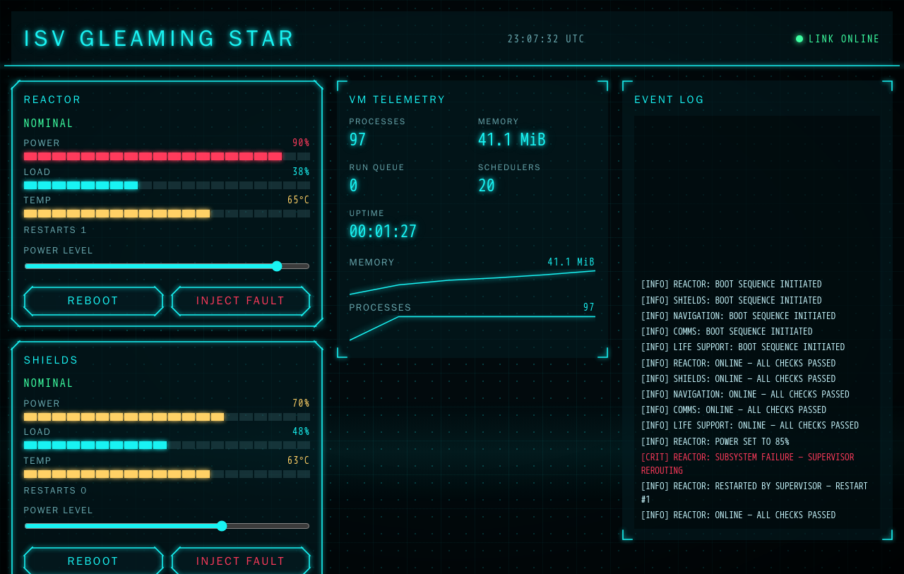
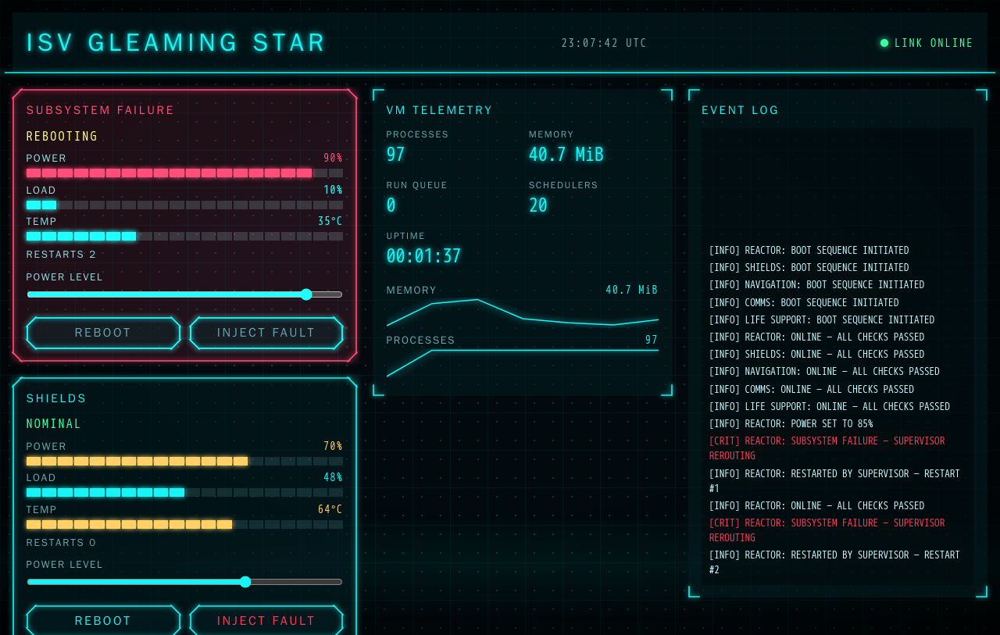

# MISSION CONTROL

A live "starship bridge computer" dashboard that runs on the BEAM, written entirely in
[Gleam](https://gleam.run): OTP actors on the server, a [Lustre](https://lustre.build) single-page
app in the browser, and one set of types shared by both.



The ship's five subsystems (Reactor, Shields, Navigation, Comms, Life Support) are separate OTP
actors under a supervisor. Press **INJECT FAULT** and one of them crashes on purpose: its panel turns
red and its title deciphers into `SUBSYSTEM FAILURE`, the journal records a `CRIT` entry, the
supervisor restarts the actor, and the status returns to `NOMINAL`. It is OTP fault tolerance you can
see.



The look is a sci-fi HUD (neon cyan, drawn borders, text that decrypts itself), *inspired by*
[Arwes](https://arwes.dev). Nothing from Arwes is used: no packages, code, SVG, sounds, fonts or
text. The ideas are re-implemented from scratch in Gleam.

## Run it

The only requirement is Docker. Nothing is compiled or executed on the host.

```sh
docker compose up --build        # → http://localhost:8000
docker compose --profile test run --rm --build test    # all tests
```

Open <http://localhost:8000/> for the dashboard and <http://localhost:8000/#/kit> for a showcase of
every UI component in every state.

If you have [`just`](https://just.systems) installed, the same things are one word each (still
inside Docker):

| Command | What it does |
|---|---|
| `just up` / `just up-d` / `just down` | start (foreground / background) and stop |
| `just test` | format check and tests in all three packages |
| `just fmt` / `just fmt-check` | format Gleam sources / check formatting |
| `just gleam <package> <args>` | run any `gleam` command, e.g. `just gleam server add mist` |
| `just ws` | stream the raw JSON event feed from `/ws` |
| `just check` | probe `/health` and `/` of the running app |
| `just clean` | remove containers, images and build artefacts |

Configuration is by environment variable: `PORT` (default `8000`) and `SHIP_NAME` (default
`ISV GLEAMING STAR`); both are set in `docker-compose.yml`.

## Architecture

```
                    ┌──────────────────────── server (Erlang target) ────────────────────────┐
                    │                                                                        │
                    │   app supervisor  (rest_for_one)                                       │
                    │   ├── hub ········ pub/sub, latest snapshot, 200-line journal,         │
                    │   │                restart counters, monitors subsystems & clients     │
                    │   ├── ship supervisor  (one_for_one, 20 restarts / 10 s)               │
                    │   │   ├── reactor      ┐                                               │
                    │   │   ├── shields      │ one actor each: drift every 500 ms,           │
                    │   │   ├── navigation   │ panic on INJECT FAULT, restarted by the       │
                    │   │   ├── comms        │ supervisor                                    │
                    │   │   └── life_support ┘                                               │
                    │   ├── telemetry ·· VM metrics once per second                          │
                    │   └── mist ······· HTTP, static files, /health, /ws                     │
                    └──────────────┬─────────────────────────────────────────────────────────┘
                       ServerEvent │ JSON over WebSocket        ▲ ClientCommand
                       (snapshot,  ▼                            │ (inject fault, reboot,
                        updates, log)                           │  set power)
                    ┌──────────────┴──────────── client (JavaScript target) ─────────────────┐
                    │  Lustre app (Model · update · view) + one requestAnimationFrame loop   │
                    └────────────────────────────────────────────────────────────────────────┘

   shared/  protocol types + JSON codecs, compiled for both targets
```

### Why it is built this way

- **One protocol, two targets.** `shared/` holds the event and command types and their hand-written
  JSON codecs. The server encodes with the same module the client decodes with, so a protocol change
  that is not handled on both sides does not compile. Every variant has a round-trip test, and the
  tests run on both Erlang and JavaScript.
- **Crashes are cheap and visible.** A subsystem that crashes is restarted by its supervisor without
  affecting the others. The hub, which outlives the crash, keeps the restart counter, notices the
  failure by monitoring the process, and reports it. A crash never reaches the application level, and
  a burst of fast faults does not bring the app down.
- **Names, not pids.** Long-lived processes are registered under names, so their address survives a
  restart. Sending to a name that is not registered would crash the sender, so commands to a
  subsystem that is mid-restart are dropped by `names.send_to_subsystem` instead of killing the
  WebSocket connection.
- **Animation lives on the client.** The server only streams domain events. All motion runs in the
  browser from a single `requestAnimationFrame` loop that starts when something animates and stops
  when everything has settled. This is why the UI is a SPA and not Lustre server components, which
  would need a round trip per frame.
- **Logic is pure, effects are at the edge.** The animator, decipher, gauge and sparkline maths, the
  subsystem simulation, the hub state and the model's event handling are plain functions with unit
  tests. Actors are tested through their public messages.

### Protocol

JSON objects with a `type` field (`snake_case`), for example:

```json
{"type":"subsystem_updated","subsystem":{"id":"reactor","status":{"type":"rebooting"},
 "power":90,"load":10,"temperature":35,"restarts":1}}
{"type":"set_power","id":"shields","level":75}
```

Server to client: `snapshot` (sent on connect), `subsystem_updated`, `vm_updated`, `logged`.
Client to server: `inject_fault`, `reboot`, `set_power`. Invalid input is logged and ignored; it
never closes the connection.

## The design system

Everything is in Gleam under `client/src/client/ui/`, plus one stylesheet. Colours exist only as CSS
custom properties.

| Module | What it does |
|---|---|
| `animator` | Pure `Anim` state machine (`Exited → Entering → Entered → Exiting`), a `Stage` that enters children one after another, and a registry of in-flight animations. Reversing mid-way continues from the current visibility. |
| `frame` | Panel borders drawn as SVG: each side is its own element so stroke thickness never distorts, and each piece draws during its share of `--p`. Variants `corners`, `octagon`, `underline`, plus `danger`. |
| `decipher` | Text that decrypts left to right from scrambled glyphs. Deterministic: the seed is a parameter. Screen readers get the final text. |
| `button` | A real `<button>` inside a frame; keyboard operable, with an accessible name and a disabled state. |
| `gauge` | 20-segment scale with `meter` semantics, coloured by thresholds. |
| `sparkline` | SVG line of the last 60 samples. |
| `log` | Terminal-style journal, `aria-live="polite"`, pinned to the newest line with CSS only. |
| `background` | Grid, dot matrix, slow scan line and vignette, all CSS. |

### Accessibility

- Text contrast is at least 4.5:1 against its background for every colour token, including the
  hovered and pressed button states.
- `prefers-reduced-motion: reduce` makes every transition instant: the animator finishes on its next
  tick, there is no stagger and no scrambling, and the scan line and pulse are switched off. The
  setting is also followed live if it changes while the page is open.
- Everything is reachable and operable from the keyboard, with a visible focus ring. Tab order is the
  reading order; the journal is focusable so it can be scrolled with the keys.
- Subsystem failures are announced through a `role="alert"` region, status changes through
  `aria-live="polite"`, and the link indicator is a `role="status"`.
- Repeated controls have unique accessible names ("Inject fault into REACTOR").

## Repository layout

```
shared/    protocol.gleam, codec.gleam                    pure Gleam, both targets
server/    hub, ship/{model,subsystem,supervisor},        target = erlang
           telemetry, names, ws, router, app, config
           priv/static/  index.html, styles.css, screenshots (client.js is built into here)
client/    model, update, view, dashboard, kit, socket,   target = javascript
           browser, route, format, ui/*
Dockerfile three stages: build (compiles and bundles), test, runtime (non-root, only the shipment)
```

## Testing

`docker compose --profile test run --rm --build test` checks formatting and runs `gleeunit` in all
three packages (the shared package on both targets). The client bundle is built with Lustre's own
dev tools, which download their bundler on first use, so the first image build needs network access.

## Notes

- Out of scope: sound, WebGL effects, multiple ships, authentication, persistence across container
  restarts.
- `client/src/client/reduced_motion_ffi.mjs` is the only hand-written JavaScript: `matchMedia` is the
  one way to read the reduced-motion setting and no Gleam package binds it.
- The server logs a crash report to stderr for every injected fault. That is OTP doing its job.

Licensed under the MIT License.
